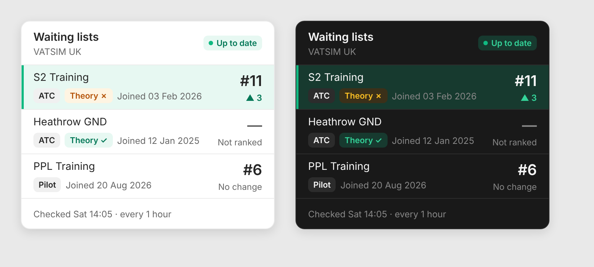

# VATSIM UK Waiting List Widget

> **Downloads:** get the latest [Android app (APK)](https://github.com/Aster-Ker/vatsim-uk-waiting-list-widget/releases/latest/download/UKWaitingLists.apk) or [Windows widget (zip)](https://github.com/Aster-Ker/vatsim-uk-waiting-list-widget/releases/latest/download/WaitingListWidget-win-x64.zip), or see all [releases](https://github.com/Aster-Ker/vatsim-uk-waiting-list-widget/releases). The Android app is described in [`android/README.md`](android/README.md).

A small always-on-top Windows desktop widget that shows your positions on the
VATSIM UK waiting lists (https://www.vatsim.uk/mship/waiting-lists) and pops a
notification when a position changes.

VATSIM UK has no public waiting-list API, so the widget reads the same page you
see when you sign in. It uses an embedded Edge (WebView2) browser. You sign in
once with VATSIM SSO, and the cookies are kept in
`%LOCALAPPDATA%\VatsimUkWaitingListWidget\WebView2`. Your password is never
seen or stored by the widget.



## Install

1. Unzip `WaitingListWidget-win-x64.zip` anywhere, e.g. `%LOCALAPPDATA%\Programs\WaitingListWidget`.
2. Run `WaitingListWidget.exe`. Windows SmartScreen may warn because the exe is
   unsigned: choose **More info → Run anyway**.
3. A sign-in window opens. Log in with VATSIM. It closes itself once your
   waiting lists load.
4. Right-click the widget or the tray icon and tick **Start with Windows** if you want it at login.

Requires Windows 10 (version 1809 or later) or Windows 11, x64, with the Edge WebView2 Runtime (preinstalled on
current Windows). No .NET install is needed; the exe is self-contained.

## Look

The UI follows the default "Panel" theme of [PanelUI](https://panelui.dev): neutral card, 1px hairline
borders, tinted status badges, and KPI-style position numbers. It switches between light and dark
with Windows (right-click → Theme to force one). It uses Inter if you have it installed, otherwise Segoe UI.

## Notifications

When a check finds a change, you get a Windows notification. The notification also stays in the notification centre. You're notified when:

- your position on any list moves up or down, e.g. "S2 Training: #14 → #11 (up 3)"
- you get a position for the first time on a list
- you're added to or removed from a list
- a theory exam starts showing as passed
- your vatsim.uk session expires and you need to sign in again

A list that moved in the last 24 hours is highlighted in the widget, green for up and red for down.
Right-click → **Notifications** turns them on or off and can send a test notification. If nothing appears,
check that Windows notifications are on and Do Not Disturb is off.

## Using it

- **Widget:** each list shows its position, ▲/▼ for the last change, the join date and,
  for ATC lists, whether the CTS theory exam shows as passed. A "—" means you're on
  the list but have no position yet (activity/hours criteria not met).
- **Tray icon:** shows your best position number. It turns amber with "!" when you need to sign in again.
- **Drag** the widget to move it. **Double-click** it to open the page in your browser,
  or to sign in when your session has expired.
- **Right-click menu:** Check now, Sign in, Always on top, Theme, Check every (15 min to 6 h,
  default 1 h), Notifications, Start with Windows, Sign out, Exit.

VATSIM UK recalculates waiting-list eligibility only every 24 hours, so checking
more often than hourly gains little. Please keep the interval reasonable.

## Files

- Settings and last-seen positions: `%LOCALAPPDATA%\VatsimUkWaitingListWidget\state.json`
- Browser profile (sign-in cookies): `%LOCALAPPDATA%\VatsimUkWaitingListWidget\WebView2`

To remove everything: Exit, untick Start with Windows first (or delete the
`VatsimUkWaitingListWidget` value under `HKCU\Software\Microsoft\Windows\CurrentVersion\Run`),
then delete the exe and that folder.

## Build from source

Requires the .NET 8 SDK.

```bash
dotnet publish -c Release -r win-x64 --self-contained true -p:PublishSingleFile=true -p:IncludeNativeLibrariesForSelfExtract=true -p:EnableCompressionInSingleFile=true -p:DebugType=none -o publish
```

If VATSIM UK changes the page layout, the extraction script is `ExtractScript` in `BrowserForm.cs`.
